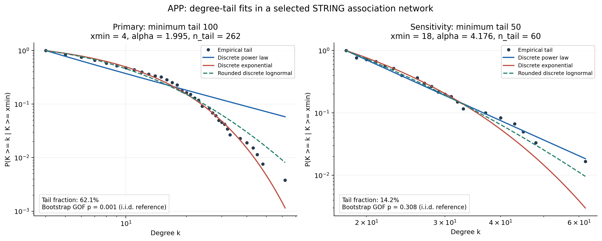

# APP Protein-Association Network: Topology and Degree-Tail Inference

A reproducible analysis of an **APP-centered human protein-association network** exported from STRING. The project describes the retained graph, identifies highly connected proteins and topological communities, and evaluates a discrete power-law model for its degree tail.

The analysis separates three questions:

1. What topology is present in this particular exported and filtered network?
2. Is a fitted power-law tail compatible with the observed degrees under the statistical reference model?
3. Does that tail fit better than exponential or lognormal alternatives on the same observations?

The degree-tail workflow uses the same MLE, cutoff selection, goodness-of-fit, and model-comparison concepts applicable to synthetic Barabási–Albert and Erdős–Rényi degree samples. Here the additional limitations are network dependence and selection of a neighborhood around one protein.

## Data and graph definition

The supplied file is `app_interactions.tsv`. Its STRING identifiers all have the human taxonomy prefix `9606.`. The file contains **14,453 distinct unordered associations and 501 distinct protein labels**, including APP. The observed combined confidence scores range from **0.4 to 0.999**. There are no missing endpoint labels, repeated unordered pairs, or self-loops in this export; each protein label maps to one STRING identifier within the file.

The analysis:

1. Retains associations with `combined_score >= 0.9`.
2. Removes APP and its incident associations.
3. Builds a simple, undirected, unweighted graph from the remaining endpoints.
4. Omits proteins with no remaining association. All descriptive statistics and degree samples use this **active-endpoint population** unless explicitly labeled as LCC results.

There are **1,807 associations among 430 endpoint proteins** after the score filter. Removing APP removes **69 associations**. The resulting analyzed graph has **422 proteins and 1,738 associations**. Of the original 500 nonquery proteins, **78 have no retained association** and are omitted; seven of these become isolated specifically after APP is removed from the thresholded graph.

A STRING combined score measures confidence in an association. It is not a measure of binding strength, and a score of 0.9 does not establish direct physical binding or experimental confirmation of every association. Removing APP changes the analyzed graph but does not remove the selection of the other proteins through an APP-centered query.

### Provenance limits

The original STRING release, retrieval date, selected network mode, evidence-channel settings, and first-/second-shell expansion settings were **not recorded in the supplied files**. They cannot be reconstructed reliably from this TSV. The included byte-identical export is the reproducible input for this analysis. Repeating a current STRING query may return different data.

SHA-256 of `app_interactions.tsv`:

```text
18752751dda3a1ac1f22672dbf3021fae1812f297c270ea24826b30fe9fdcece
```

## Reproduce the analysis

Install the dependencies listed in `requirements.txt`, then run the scripts from the repository directory:

```bash
python -m pip install -r requirements.txt
python app_analysis.py
python fit_degrees.py
```

The first script writes descriptive tables and the two root-level figures. The second evaluates the degree-tail models and writes its results under `output/`. The input graph is loaded independently by each script; neither requires manual copying of results from the other. Random-number settings and package versions for the inference run are recorded in `output/run_metadata.json`.

## Descriptive results

| Metric | Value | Population |
| --- | ---: | --- |
| Proteins | 422 | Full active-endpoint graph |
| Associations | 1,738 | Full active-endpoint graph |
| Mean degree | 8.2370 | Full active-endpoint graph |
| Mean local clustering | 0.3860 | Full active-endpoint graph |
| Density | 0.019565 | Full active-endpoint graph |
| Connected components | 6 | Sizes 408, 4, 3, 3, 2, 2 |
| Largest connected component (LCC) | 408 proteins, 1,724 associations | 96.68% of analyzed proteins |
| Greedy-modularity communities | 12 | LCC only |
| Modularity | 0.51405 | LCC partition |

The density is also reported as the parameter `p` of a density-matched Erdős–Rényi reference. Interpreting `p` as a clustering reference is a theoretical approximation; no random-graph ensemble is simulated here. The ratio of observed clustering to this reference is **19.73**. This ratio alone is not a small-world test: average path lengths and an appropriate reference comparison have not been evaluated.


### Centrality and communities

Degree and normalized, unweighted betweenness centrality are calculated on the full active-endpoint graph. TP53 ranks first in both; MAPT ranks fourth by degree and third by betweenness. APOE has degree 18 and ranks eighth by betweenness in this graph. These are properties of the selected association graph, not evidence of causal disease mechanisms or molecular transport through its shortest paths.

Ties in displayed rankings are ordered by protein label. All node-level results are exported to `output/node_metrics.csv`.

Community detection uses greedy modularity maximization on the LCC. Colors and identifiers represent **topological communities**. No functional-enrichment analysis is performed, and modularity does not validate a biological pathway assignment. Community membership is exported rather than inferred from a few example proteins.


## Discrete power-law inference

For positive integer observations `x >= xmin`, the fitted tail model is

$$
P(X=x\mid X\ge x_{\min}) = \frac{x^{-\alpha}}{\zeta(\alpha,x_{\min})},
\qquad \alpha>1,
$$

where the denominator is the Hurwitz zeta function. In the code and tables the parameters are named **`alpha`** and **`xmin`**.

For each eligible observed cutoff, the exponent is estimated by numerical maximum likelihood for this discrete distribution. The selected cutoff minimizes the discrete Kolmogorov–Smirnov (KS) distance. The KS calculation accounts for the integer support and gaps between observed values. It is not a linear regression of logarithms, and the old fixed-cutoff CCDF regression is no longer used as an exponent estimator.

### Primary analysis and tail-size sensitivity

The primary analysis requires **at least 100 tail observations**. A second, explicitly labeled sensitivity analysis requires at least 50. These constraints avoid selecting a visually favorable tail containing only a handful of proteins; neither threshold guarantees sufficient statistical power.

| Analysis | Minimum tail size | Selected `xmin` | Tail proteins | Fraction of analyzed proteins | MLE `alpha` | KS | Bootstrap GOF `p` |
| --- | ---: | ---: | ---: | ---: | ---: | ---: | ---: |
| Primary | 100 | 4 | 262 | 62.09% | 1.99486 | 0.11761 | 0.0010 |
| Sensitivity | 50 | 18 | 60 | 14.22% | 4.17632 | 0.07168 | 0.3077 |

`output/xmin_sensitivity.csv` records the eligible cutoff fits, and `output/xmin_sensitivity.png` shows how the estimated exponent, fit distance, and retained sample size change. The two selected cutoffs describe substantially different subsets of the data. Neither exponent should be generalized automatically to the entire graph.

### Bootstrap goodness of fit

Each analysis uses **1,000 semiparametric bootstrap replicates**. Synthetic samples combine an empirically resampled body below `xmin` with values generated from the fitted discrete power-law tail. Both `xmin` and `alpha` are fitted again in every replicate under the same minimum-tail constraint used for the observed sample.

The reported bootstrap p-value compares the observed KS distance with the refitted distances and uses the finite-simulation correction `(exceedances + 1) / (B + 1)`. A small value, conventionally below 0.1 in this workflow, argues against the fitted model **under this reference procedure**. A larger value means that this procedure did not reject the model; it does not prove a power law. Individual bootstrap distances and Monte Carlo uncertainty are retained in the output files.

The primary run has **0 of 1,000** bootstrap distances at least as large as the observed distance: its reported p-value is `1/1001`, not zero. The sensitivity run has **307 of 1,000**, giving `308/1001 = 0.3077`. Its approximate Monte Carlo standard error is **0.0146**, and the 95% Wilson interval for the underlying bootstrap exceedance probability is **0.2792–0.3363**. These uncertainty measures concern the finite simulation, not uncertainty about the biological network or a confidence interval for `alpha`.

The primary tail is rejected by this independent-observation reference diagnostic. The shorter, 60-protein sensitivity tail is not rejected. This change shows the importance of the retained range and sample size; it does not establish a global scale-free topology.

### Alternative models and an independent package check

The `powerlaw` package is used for an independent, exact-discrete power-law exponent check at the already selected `xmin`, and for likelihood-based comparisons with exponential and lognormal tails. The lognormal uses the package's rounded discrete approximation. This is an independent numerical check, not a second independent dataset.

All competing models within one analysis are fitted to **the same observations above the same cutoff**. The comparison table includes log likelihood, AIC, the log-likelihood ratio `R`, and its approximate `p_lr`:

- Positive `R = log L(power law) - log L(alternative)` favors the power law; negative `R` favors the alternative.
- `p_lr` assesses whether the likelihood difference is distinguishable from zero under the comparison's assumptions. It is **not** the bootstrap goodness-of-fit p-value.
- Smaller AIC indicates a better penalized likelihood among the fitted candidates on that same tail. AIC values from the primary and sensitivity analyses are not directly comparable because their observation sets differ.
- A model can win a relative comparison while still providing an inadequate absolute fit. Numerical warnings and fit diagnostics should be considered alongside the rankings.

Full results are in `output/model_comparison.csv`. The exact-discrete exponent check and settings are recorded with the inference outputs.

| Model | Primary tail: delta AIC | Sensitivity tail: delta AIC |
| --- | ---: | ---: |
| Power law | 66.694 | 0.000 |
| Exponential | 0.000 | 0.187 |
| Rounded discrete lognormal | 8.200 | 1.150 |

For the primary tail, both alternatives have higher fitted likelihood than the power law; the exponential has the lowest AIC among the three candidates. The power-law-versus-exponential comparison gives `R = -33.347` and `p_lr = 4.72e-5`; the power-law-versus-lognormal comparison gives `R = -30.247` and `p_lr = 2.62e-6`. These are relative, independent-observation diagnostics and do not test the alternatives' absolute goodness of fit.

For the sensitivity tail, AIC differences are small and the likelihood-ratio p-values are **0.9585** against the exponential and **0.5670** against the lognormal. These comparisons do not distinguish the candidates clearly. The independent package exponent estimates differ from the custom MLE estimates by less than **0.000026** in both analyses.



## Interpretation limits

- **Dependent degrees:** Degrees from a single graph are not independent observations. The bootstrap and likelihood-ratio p-values use an independent-observation reference model and are therefore **exploratory diagnostics**, not calibrated significance tests for the original protein-network sampling process.
- **Selected neighborhood:** Protein inclusion, confidence filtering, removal of APP, and omission of isolates define the analyzed population. Results cannot be generalized to the complete human interactome or a complete Alzheimer's disease network.
- **Finite graph:** The unbounded discrete power law is a tail-model approximation. Degrees in this finite graph have a maximum possible value; synthetic reference samples do not recreate the original network or its selection process.
- **Limited tail data:** The sensitivity fit retains only 60 proteins and spans a short range of degrees. Nonrejection of a model on such a tail can reflect limited ability to distinguish alternatives.
- **Scope of conclusions:** Neither a fitted exponent, a favorable likelihood comparison, a clustering ratio, nor a modularity value alone establishes scale-free organization, small-world structure, biological function, or disease causality.

## Repository contents

| File | Purpose |
| --- | --- |
| `app_analysis.py` | Validated graph construction, descriptive metrics, centralities, communities, and empirical figures |
| `fit_degrees.py` | Degree-tail inference entry point |
| `powerlaw_analysis.py` | Shared discrete fitting, bootstrap, comparison, and plotting implementation |
| `app_interactions.tsv` | Supplied STRING export, unchanged |
| `requirements.txt` | Python dependencies |
| `degree_distribution.png` | Empirical degree PMF and inclusive CCDF |
| `network_communities.png` | LCC layout, algorithmic community colors, and labeled hubs |
| `output/network_summary.csv` | Graph metrics, input hash, and filtering counts |
| `output/node_metrics.csv` | Per-protein degree, centralities, component, and LCC community |
| `output/community_membership.csv` | LCC community identifiers and sizes |
| `output/degree_counts.csv` | Integer degree counts, probabilities, and CCDF |
| `output/fit_summary.csv` | Primary and sensitivity fit estimates, GOF results, and diagnostics |
| `output/xmin_sensitivity.csv` | Exponent, KS distance, and tail size across cutoff choices |
| `output/model_comparison.csv` | Competing-model likelihoods, AIC, and likelihood-ratio diagnostics |
| `output/bootstrap_ks.csv` | Refitted bootstrap KS distances |
| `output/tail_fits.png` | Empirical tails and fitted candidate models |
| `output/xmin_sensitivity.png` | Sensitivity to cutoff selection |
| `output/run_metadata.json` | Inference settings, random seeds, and runtime versions |

## References

- Clauset, A., Shalizi, C. R., & Newman, M. E. J. (2009). *Power-law distributions in empirical data*. SIAM Review, 51(4), 661–703. [doi:10.1137/070710111](https://doi.org/10.1137/070710111); [author manuscript](https://arxiv.org/abs/0706.1062).
- Alstott, J., Bullmore, E., & Plenz, D. (2014). *powerlaw: A Python Package for Analysis of Heavy-Tailed Distributions*. PLOS ONE, 9(1), e85777. [doi:10.1371/journal.pone.0085777](https://doi.org/10.1371/journal.pone.0085777).
- STRING. [Network types, evidence, and confidence scores](https://en.string-db.org/help/scores/).
- NetworkX. [Modularity](https://networkx.org/documentation/stable/reference/algorithms/generated/networkx.algorithms.community.quality.modularity.html) and [small-world measures](https://networkx.org/documentation/stable/reference/algorithms/smallworld.html).
