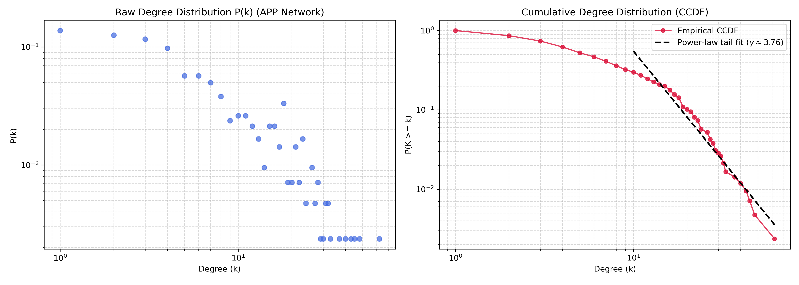
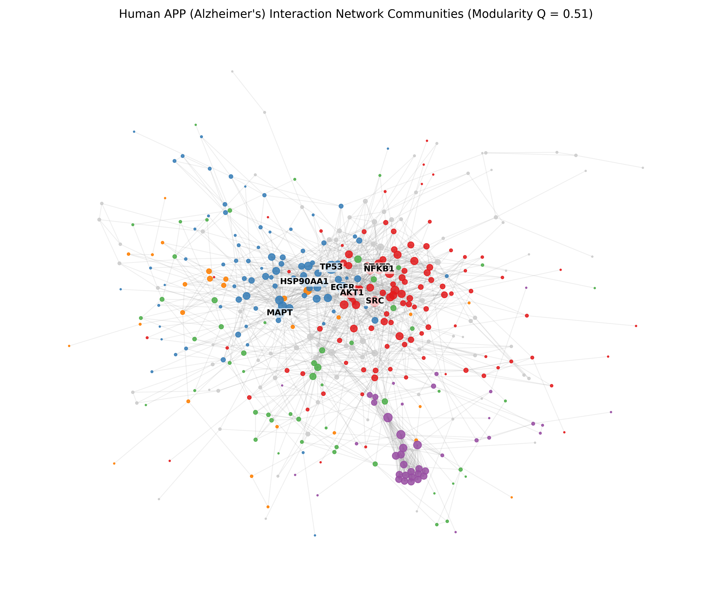

# Topological and Community Analysis of the Human APP (Alzheimer's Disease) PPI Network

## Overview
This repository presents a complex network analysis of the human **Amyloid Precursor Protein (APP)** Protein-Protein Interaction (PPI) network, extracted from the **STRING database** (*Homo sapiens*, Taxonomy ID: 9606). APP is the central pathological precursor in **Alzheimer's disease**. Beyond characterizing the scale-free topology, small-world clustering, and community structure of the Alzheimer's interactome, this project provides a **comparative topological analysis** against the nuclear DNA-repair network (`BRCA1`).

## Methodological Preprocessing
1. **High-Confidence Backbone Extraction:** From $14,453$ raw interactions across $501$ proteins (`combined_score >= 0.4`), edges were filtered to retain only **Highest Confidence biochemical interactions (`combined_score >= 0.9`)**, yielding a clean backbone of $N = 422$ nodes and $L = 1,738$ edges.
2. **Ego-Node Removal:** The central query protein (`APP`) was removed prior to topological evaluation to eliminate star-graph sampling bias and uncover intrinsic inter-modular pathways.
3. **CCDF Power-Law Estimation:** Using the **Complementary Cumulative Distribution Function (CCDF, $P(K \ge k)$)** on the tail ($k \ge 10$), we smoothed finite-size statistical fluctuations to estimate the scaling exponent $\gamma \approx 3.76$.

## Key Empirical Findings

### 1. Global Network Topology & Comparative Biology (APP vs. BRCA1)
Comparing the neuro-signaling **APP** network with the nuclear DNA-repair **BRCA1** network (sampled under identical STRING parameters) reveals fundamental structural differences between cellular subsystems:

| Topological Metric | APP Network (Alzheimer's / Signaling) | BRCA1 Network (DNA Repair / Chromatin) | Structural Interpretation |
| :--- | :--- | :--- | :--- |
| **Nodes ($N$)** | $422$ | $474$ | Comparable active proteome size |
| **Edges ($L$)** | $1,738$ | $5,300$ | Nuclear chromatin complexes are ~3x denser than membrane/signaling pathways |
| **Average Degree ($\langle k \rangle$)** | $8.24$ | $22.36$ | Lower local connectivity in extracellular & synaptic transduction |
| **Clustering Coefficient ($\langle C \rangle$)** | $0.386$ | $0.552$ | Both exhibit strong local clustering |
| **Random Null Model ($C_{\text{rand}}$)** | $0.0196$ | $0.0472$ | Expected clustering in equivalent Erdős–Rényi graphs |
| **Small-World Ratio ($\langle C \rangle / C_{\text{rand}}$)** | **$19.7\times$** | **$11.7\times$** | APP shows nearly 20x higher clustering than random expectation |
| **Modularity Score ($Q$)** | **$0.514$** ($12$ modules) | **$0.506$** ($6$ modules) | Higher functional compartmentalization across diverse neural pathways |



### 2. Local Hubs vs. Pathological Network Bridges (Centrality Analysis)
Contrasting **Degree Centrality** with **Betweenness Centrality** uncovers how major genetic risk factors for neurodegeneration operate as inter-modular bridges rather than massive local cliques:

| Rank | Protein | Degree Centrality | Degree ($k$) | Protein | Betweenness Centrality | Degree ($k$) | Pathological & Topological Role |
| :--- | :--- | :--- | :--- | :--- | :--- | :--- | :--- |
| **1** | **TP53** | 0.1473 | 62 | **TP53** | 0.1111 | 62 | Apoptotic & Cellular Stress Super-Hub |
| **2** | **EGFR** | 0.1140 | 48 | **EGFR** | 0.0997 | 48 | Neurotrophic & Receptor Tyrosine Kinase Hub |
| **3** | **AKT1** | 0.1069 | 45 | **MAPT** | 0.0984 | 43 | **Tau Protein** — Core Neurofibrillary Bridge |
| **4** | **MAPT** | 0.1021 | 43 | **AKT1** | 0.0759 | 45 | Neuronal Survival & Insulin Signaling Kinase |
| **5** | **SRC** | 0.0950 | 40 | **SRC** | 0.0542 | 40 | Synaptic Tyrosine Kinase Connector |
| **6** | **STAT3** | 0.0879 | 37 | **GNAI2** | 0.0536 | 31 | GPCR Signal Transduction Broker |
| **7** | **NFKB1** | 0.0784 | 33 | **ALB** | 0.0505 | 22 | Extracellular Carrier & Clearance Bridge |
| **8** | **HSP90AA1**| 0.0760 | 32 | **APOE** | **0.0479** | **18** | **Primary Alzheimer's Genetic Risk Bridge** |
| **9** | **CTNNB1** | 0.0760 | 32 | **SNCA** | **0.0479** | **28** | **Alpha-Synuclein** — Synaptic/Autophagy Broker |
| **10**| **JUN** | 0.0736 | 31 | **GNB1** | 0.0420 | 29 | Heterotrimeric G-Protein Subunit Bridge |

- **Discovery of Low-Degree Topological Brokers (`APOE` & `SNCA`):** The most striking network finding is **`APOE`** (Apolipoprotein E, the single strongest genetic risk factor for sporadic Alzheimer's disease). Despite having a modest degree ($k = 18$, absent from the top-10 degree hubs), `APOE` ranks **8th in Betweenness Centrality**. Similarly, **`SNCA`** (Alpha-synuclein, $k = 28$) ranks **9th in Betweenness**. Topologically, `APOE` and `SNCA` act as critical structural bottlenecks connecting lipid metabolism and synaptic vesicle trafficking to neuro-inflammatory and apoptotic cascades.
- **The Tau Hub (`MAPT`):** Microtubule-associated protein tau (`MAPT`, $k = 43$) ranks 4th in Degree and rises to 3rd in Betweenness Centrality, confirming its central bottleneck position integrating axonal transport with intracellular signaling (`AKT1`, `SRC`, `TP53`).

### 3. Community Structure & Functional Modules
Applying **Greedy Modularity Maximization** on the Largest Connected Component ($N_{\text{LCC}} = 408$, $L_{\text{LCC}} = 1,724$) partitioned the interactome into **$12$ distinct communities** with a high modularity score of **$Q = 0.514$**:
- **Community 1 (110 nodes — Lipoprotein & Neurotrophic Receptors):** Includes `LRP8`, `VLDLR`, `APOB`, `NTRK1`, and `C4B` (linking cholesterol transport and complement cascade activation).
- **Community 2 (89 nodes — Synaptic Pathology, Autophagy & Cytoskeleton):** Includes `SNCA`, `BIN1` (major late-onset AD risk gene), `MAP1LC3A`, and `ACTB`.
- **Community 3 (53 nodes — Amyloid Degradation & Neuropeptide Signaling):** Includes `MME` (Neprilysin, a primary amyloid-beta degrading enzyme), `SST`, and `LINGO1`.
- **Community 4 (41 nodes — GPCR & Calcium Signaling):** Includes `PLCB1`, `GNG13`, `GNG3`, and `GNB4`.
- **Community 5 (27 nodes — Microglial Activation & Prion-like Innate Immunity):** Includes `TYROBP`, `CD68`, and `PRNP`.



## Repository Structure & Usage
- `app_analysis.py` — Python script for data preprocessing, CCDF power-law fitting, centrality comparison, and community visualization.
- `app_interactions.tsv` — Raw PPI dataset exported from STRING.
- `degree_distribution.png` — Side-by-side log-log plot of raw $P(k)$ vs. CCDF with power-law fit.
- `network_communities.png` — Community-colored network graph highlighting primary hubs.

To reproduce the analysis:
```bash
pip install numpy pandas networkx matplotlib
python app_analysis.py
```